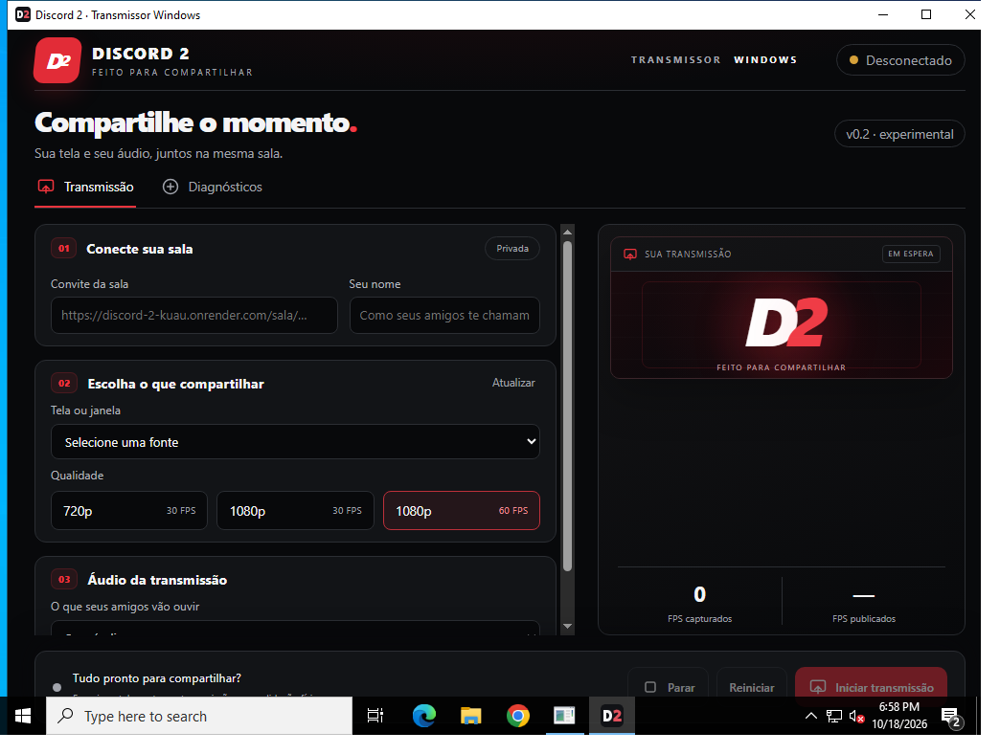

# Build Windows experimental — 18/10/2026

[Execução aprovada 39154249266](https://github.com/Vivi7-sys/discord-2/actions/runs/39154249266), branch `migration/windows-rust-tauri2`, commit compilado `7ff0b7f0b0a3a19c3b52770254080a486b118f37`. Mudanças posteriores exclusivamente de documentação/evidência não recompilam nem modificam esse instalador.

## Pacote e testes

[Artifact `discord2-rust-windows-evidence-7`](https://github.com/Vivi7-sys/discord-2/actions/runs/39154249266/artifacts/12147425939), disponível para quem tem acesso ao repositório, com retenção de 14 dias. Arquivo dentro do ZIP: `artifacts/Discord2Transmissor-0.2.0-alpha.1-experimental-windows-x64-setup.exe`.

SHA-256 do instalador: `6698F0C007A22217B53BA5C7C02FDCE007DCAF466A50950B67CF194D83904752`.

Não é uma release pública nem um pacote assinado. Captura, áudio e transmissão ainda não foram validados em Windows físico. O aplicativo e o pacote são identificados como experimentais.

| Verificação executada em Windows x64 | Resultado |
| --- | --- |
| Contrato dos estilos/ícones reais do site e TypeScript/Vite | Aprovado |
| React/Playwright em Chromium Windows | 6 testes aprovados; fixture IPC não transmite mídia |
| Rust em `release` | 7 testes aprovados: configuração e integração HTTP com servidor controlado |
| Conversão nativa libyuv | 1 benchmark/teste sintético aprovado |
| Formatação e Clippy, todos os targets, `-D warnings` | Aprovados |
| LiveKit/WebRTC C++, Windows SDK/MSVC, Tauri com assets locais | Compilados e linkados, sem `DOCS_RS` |
| Abertura e captura da janela nativa | Aprovadas, antes e depois da instalação |
| NSIS: instalar, verificar payload, abrir e desinstalar | Aprovado; nenhum arquivo Python/Qt encontrado |
| WGC real e sessão LiveKit com receptor | 2 testes ignorados por requisito de ambiente dedicado; não executados |

[Resultados dos testes](evidence/windows-test-results.txt), [verificação do instalador](evidence/installer-check.json), [ambiente](evidence/windows-runner-environment.json) e [escopo experimental](evidence/EXPERIMENTAL-WINDOWS.json).

O runner era Windows Server 2022 Datacenter, build 20348, x64, 2 processadores lógicos AMD EPYC 7763, Microsoft Hyper-V Video, Rust 1.99.1 e Node 24.21.0. Não representa Windows 11 com GPU física.

## Erros reais corrigidos

1. Headers Abseil excediam MAX_PATH na árvore de build aninhada. O target passou a `D:\d2-target`; o header existia no arquivo oficial do WebRTC.
2. O WebRTC oficial usava `/MT`, mas a ponte C++/Rust usava `/MD`. A configuração Windows usa `+crt-static` e target MSVC explícito, preservando proc macros no host. Não foram usados argumentos para ignorar símbolos duplicados.
3. O Tauri altera `__TAURI_BUNDLE_TYPE_VAR_UNK` para `NSS` no binário NSIS e restaura o original após empacotar. O teste agora exige SHA-256 integral correspondente exatamente a essa alteração, sem aceitar outras diferenças. [Implementação oficial](https://github.com/tauri-apps/tauri/blob/dev/crates/tauri-bundler/src/bundle.rs).
4. O upload rejeitava o target fora do checkout. O instalador é copiado para `artifacts/`, com checksum, antes do upload. O cache está separado para o CRT corrigido; testes e Clippy usam o perfil de produção.

## Interface real e comparação

[Outra captura nativa](evidence/windows-native-tauri.png) · [referência publicada do site](evidence/reference-render-site.png) · [contrato dos tokens](evidence/published-css-comparison.json).

As capturas nativas vêm de `CopyFromScreen` sobre o HWND do executável Tauri, e não de Chromium/Linux. O desktop virtual pequeno do runner cortou a parte inferior e incluiu a barra de tarefas; a imagem prova renderização nativa dos elementos visíveis, não o layout inteiro ou comportamento em DPI alto. Os testes Playwright de tamanhos menores são evidência separada de navegador.

O fundo preto, superfícies, bordas arredondadas, vermelho, cartões, ícones SVG e tipografia do site permanecem na interface Windows. CSS do site e `RoomIcon` são reutilizados e verificados pelo teste de identidade. A marca D2 da prévia reaproveita o tratamento branco/vermelho; os controles são organizados para transmissão desktop. A barra de título branca é a decoração do Windows do runner. A fonte resolvida e o antialiasing diferem entre sistemas; não se afirma equivalência pixel a pixel com a referência Linux do site.

## Benchmark sintético

128 conversões por perfil, BGRA com padding → libyuv SIMD → I420; somente tempo da conversão, sem alocação/captura/escala/encoder/rede. [Dados brutos](evidence/windows-synthetic-conversion.json).

| Perfil solicitado | Média de conversão | p95 |
| --- | --- | --- |
| 720p30 | 0,198 ms | 0,242 ms |
| 1080p30 | 0,431 ms | 0,452 ms |
| 1080p60 | 0,427 ms | 0,447 ms |

Esses valores não são FPS capturados, codificados, publicados ou decodificados. Não demonstram fluidez, latência, sincronização A/V ou ausência de regressão frente ao transmissor anterior.

## Validação física restante

[Procedimento completo Windows 11](TESTE-WINDOWS-11.md): instalação/inicialização, conexão à sala com espectador independente, exclusividade, monitor/janela, três perfis, áudio ausente/aplicativo/sistema, exclusão do Discord, reprodução local intacta, FPS reais, sincronização, falhas, parada e reinício.

As implementações Rust foram preservadas e compiladas; não há dependência do antigo Python/Qt no pacote. Permanecem dependências nativas legítimas do LiveKit/WebRTC C++ e Windows/WebView2. Autenticação, captura WGC, publicação LiveKit, áudio WASAPI e comportamento em sessão real não foram comprovados por este job.

Validar isolamento durante reinício dos processos antes de confiar na exclusão do Discord: a checagem atual é periódica. Discord PTB/Canary e Discord no navegador não estão cobertos. Não existe fallback automático para microfone ou áudio global.

O caminho atual usa readback/conversão CPU. GPU → encoder sem cópias, NVENC/AMF/Quick Sync, HDR e GPUs híbridas ainda precisam de implementação/validação conforme [NATIVE-PIPELINE.md](NATIVE-PIPELINE.md). Compilação aprovada não significa migração final concluída.

`main` foi conferida em leitura e permaneceu em `0c84dcf640ec14336fac3defe5a2ccd9f56f090b`. Nenhuma release, deploy, alteração de Linux, site ou Render foi realizada.
